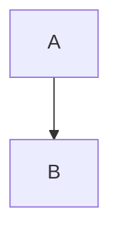

# check-mmdjs-action

GitHub Action that scans Markdown files for fenced Mermaid blocks, plus standalone `.mmd`/`.mermaid` files, and fails the workflow when any diagram has invalid Mermaid syntax.

The action uses Mermaid's parser API with JSDOM for syntax-only validation. It does **not** render diagrams and does not launch Puppeteer or Chrome, so runner Chrome dependency failures are not reported as invalid diagrams. Parser runtime/setup failures, such as DOMPurify/JSDOM integration errors, are reported as environment errors instead of invalid diagrams.

It detects code fences such as:

````markdown

````

## Usage

```yaml
name: Check Mermaid diagrams

on:
  pull_request:
  push:

jobs:
  mermaid:
    runs-on: ubuntu-latest
    steps:
      - uses: actions/checkout@v4
      - uses: stonecharioteer/check-mmdjs-action@v3.1
```

## Inputs

| Input | Default | Description |
| --- | --- | --- |
| `files` | `**/*.md`, `**/*.markdown`, `**/*.mmd`, `**/*.mermaid` | Newline- or comma-separated glob patterns to scan. |
| `ignore` | `.git/**`, `node_modules/**` | Newline- or comma-separated glob patterns to ignore. |
| `mermaid-version` | `latest` | Version of the `mermaid` npm package used for parser API syntax validation. |
| `mermaid-cli-version` | empty | Deprecated alias for `mermaid-version`; kept for backwards compatibility. |
| `fail-fast` | `false` | Stop after the first invalid diagram. |
| `output-dir` | empty | Optional directory where extracted `.mmd` files are kept. |
| `config-file` | empty | Optional Mermaid config JSON file passed to `mermaid.initialize` before parsing. |
| `puppeteer-config-file` | empty | Deprecated and ignored. v3 does not use Puppeteer or Chrome. |
| `mmdc-args` | empty | Deprecated and ignored. v3 does not use `mermaid-cli`. |

Example with options:

```yaml
- uses: stonecharioteer/check-mmdjs-action@v3.1
  with:
    files: |
      docs/**/*.md
      README.md
      diagrams/**/*.mmd
    ignore: |
      docs/archive/**
    mermaid-version: 11.4.1
    output-dir: .mermaid-output
    fail-fast: true
```

## Troubleshooting

If `@v3` reports `purify.sanitize is not a function` or `purify.addHook is not a function`, change the action reference to `@v3.1`. The `v3` tag points to the parser implementation without JSDOM. The fix is in `v3.1`; rerunning a workflow that still uses `v3` does not apply it.

## Development

Run the integration tests with Node 24. The tests install Mermaid and JSDOM from npm and need network access.

```sh
node --test test/action.test.js
TEST_MERMAID_VERSION=11.4.1 node --test test/action.test.js
```

CI tests the documented Mermaid version and `latest`. The tests cover inline theme directives, HTML labels, syntax errors, unclosed fences, fail-fast counts, dependency failures, temporary file cleanup, retained output files, and files without diagrams.

Commit messages are checked against the Conventional Commits format.

Using [`pre-commit`](https://pre-commit.com/):

```sh
pre-commit install --hook-type commit-msg
```

Or with Git's native hooks path:

```sh
git config core.hooksPath .githooks
```

## Notes

- The action runs on Node 24 and installs the `mermaid` and `jsdom` npm packages in a temporary directory for parser API validation. It removes this directory on success or failure. Files saved with `output-dir` remain available.
- Workflow annotations point to the Markdown file and line where the failing Mermaid fence starts, or line 1 for standalone `.mmd`/`.mermaid` files.
- Fences labelled `mermaid`, `mmd`, or `mermaidjs` are checked. An unclosed fence continues to the end of the file, as specified by Markdown.
- Standalone `.mmd` and `.mermaid` files are treated as one diagram each.
